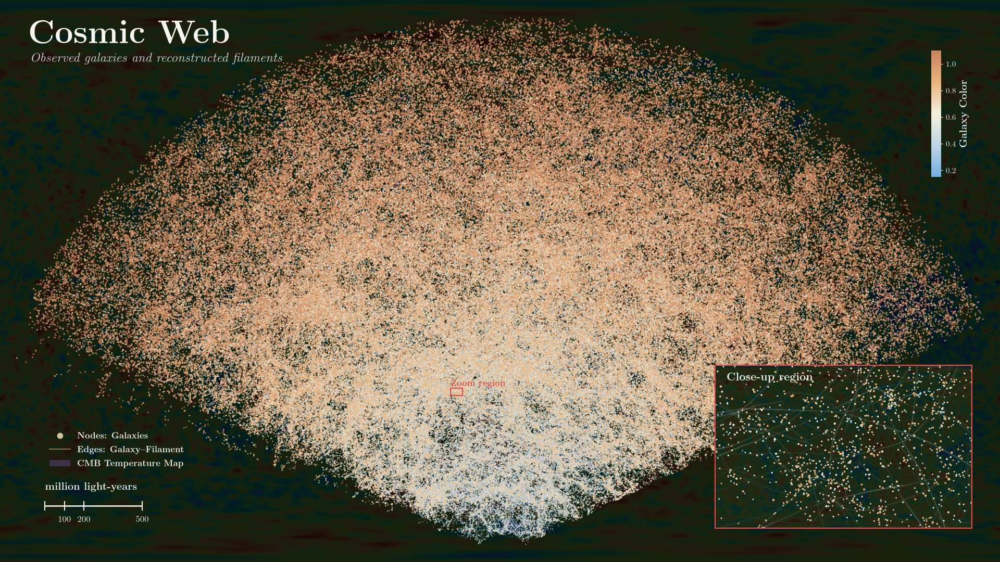
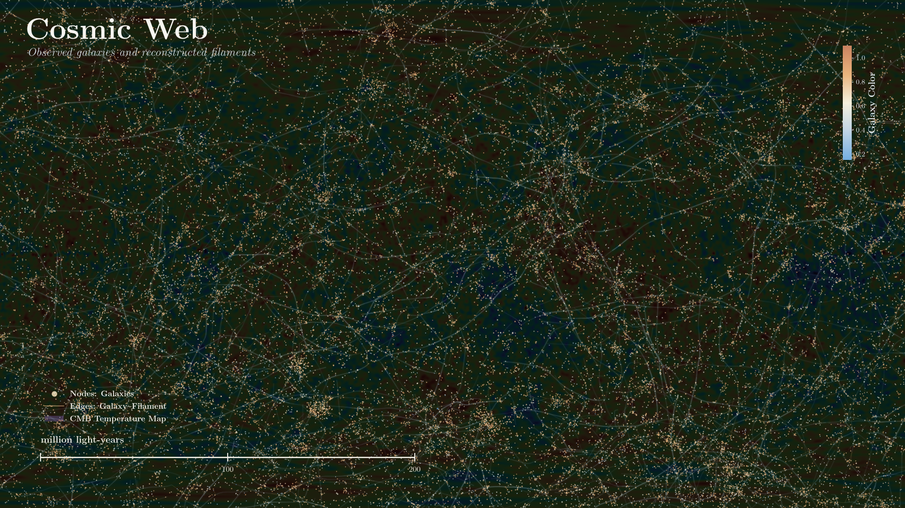

<h1 align="left"> Cosmic Web Network Visualization </h2>

<h4 align="left">by <a href="https://www.linkedin.com/in/q-tran/">Tuan Tran</a><sup>a</sup></h4>

<sup>a</sup> Graduate Research Assistant @ AiRIS Lab, Department of Civil & Environmental Engineering, Walter Scott, Jr. College of Engineering, Colorado State University, Fort Collins, CO, 80521, U.S.A., E-mail: tuan.tran@colostate.edu

## Introduction
The cosmic web, known as the largest known structure in the universe, comprises of galaxies, superclusters, filament, and enormous cosmic voids. Galaxies are not randomly distributed through space; instead, they are concentrated along cosmic filaments. The reasons are due to gravity and dark matters. Gravity attracts matter towards dense regions, and dark matter supplies and bolsters this gravitational strength.

The cosmic web can be descried as a network! The nodes represent galaxies, and edges represent cosmic filaments; together, they form an interconnected structure. In layman term, the cosmic web can be though of as the universe's highway system. The cities are galaxy clusters; the highways are cosmic filaments; the sparse regions are the cosmic voids. 

This project explores the large-scale structure of the nearby observable universe using galaxies from the Sloan Digital Sky Survey (SDSS), filament reconstructions published by Tempel et al. (2014), and the NASA WMAP nine-year cosmic microwave background (CMB) temperature map. In total, the datasets comprise of around 580,000 galaxies and 16,000 reconstructed filaments.

The color of the galaxy measures the brightness: The bluer galaxies contain young, massive stars while the redder galaxies contain older stars.


**Figure 1**: Visualization of the cosmic web with datasets obtained from Tempel et al. (2014), and the NASA WMAP nine-year CMB temperature map. 
> **Note:** The galaxies and cosmic microwave background (CMB) temperatures are based on observations. The filaments are inferred from the galaxy distribution. Galaxy–filament edges are derived from proximity.

## Close-Up View


**Figure 2**: Close-up of the cosmic web showing the network of galaxies and filaments. 

## Network Representations

| Visual Element | Data Source and Meaning |
|---|---|
| **Galaxy nodes** | SDSS galaxies. Each node represents one observed galaxy. |
| **Node Size** | Luminosity. Larger markers suggest more luminous galaxies. |
| **Node Color** | Galaxy color |
| **Galaxy–filament Edges** | Thin edges indicate proximity to a filament. |
| **CMB Background** | WMAP nine-year ILC temperature fluctuations. A visual representation of early-universe temperature anisotropies. |

## How to Run

### 1. Clone the repository
```
https://github.com/tuan-tran-24/SYSE580-F26-NetworkVisualization.git
```
### 2. Check the local data
Download all the files in `data/`:

- `tempel_sdss_galaxies.csv`
- `tempel_sdss_filament_points.csv` 
- `wmap_ilc_9yr_v5.fits` 

### 3. Install requirements
In Anaconda Prompt: 
```
conda install -c conda-forge numpy pandas scipy matplotlib plotly astropy healpy pillow jupyterlab ipykernel -y
```
### 4. Run the notebook

Open and run `visualization.ipynb`

## References

* *Galaxy filament.* (n.d.). In *Wikipedia*. Retrieved November 8, 2026, from https://en.wikipedia.org/wiki/Galaxy_filament

* Jet Propulsion Laboratory. (2026, January 26). *NASA reveals new details about dark matter’s influence on universe*. NASA. https://www.nasa.gov/missions/webb/nasa-reveals-new-details-about-dark-matters-influence-on-universe/

* NASA/IPAC Infrared Science Archive. (n.d.). *Planck public data release 3 maps: CMB maps* [Data set]. https://irsa.ipac.caltech.edu/data/Planck/release_3/all-sky-maps/matrix_cmb.html

* National Aeronautics and Space Administration. (2012). *WMAP DR5 ILC map* [Data set]. LAMBDA. https://lambda.gsfc.nasa.gov/product/wmap/dr5/ilc_map_get.html

* National Aeronautics and Space Administration. (2026, August 12). *Large scale structures*. NASA Science. https://science.nasa.gov/universe/galaxies/large-scale-structures/

* Rudakovskyi, A., Vazza, F., & Tsizh, M. (2025). *The network analysis of the cosmic web as a tool to constrain cosmology and cosmic magnetism* [Preprint]. arXiv. https://doi.org/10.48550/arXiv.2511.22573

* Tempel, E., Stoica, R. S., Martínez, V. J., Liivamägi, L. J., Castellan, G., & Saar, E. (2014). Detecting filamentary pattern in the cosmic web: A catalogue of filaments for the SDSS. *Monthly Notices of the Royal Astronomical Society, 438*(4), 3465–3482. https://doi.org/10.1093/mnras/stt2454

## AI Usage
ChatGPT was used to obtain the data, write and debug the code, and prepare the documentation along with the repository.
